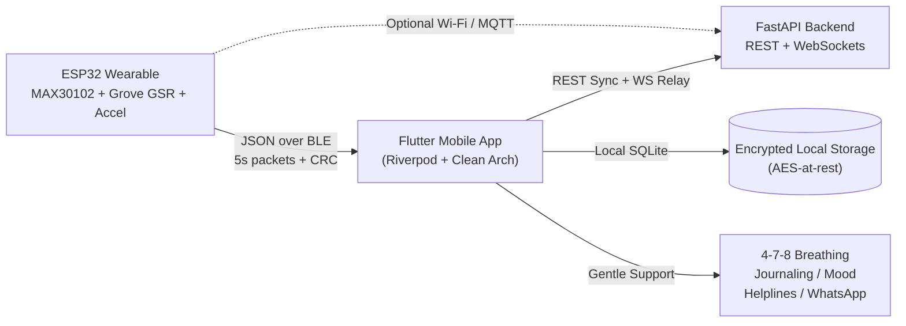

# EmotiGuard: IoT Emotional Distress Detection & Support System

**EmotiGuard** is an end-to-end IoT and mobile health platform that detects acute and gradual emotional distress through continuous biometric monitoring (Heart Rate, HRV RMSSD, Electrodermal Activity / EDA, and 3-axis Movement).

---

## System Architecture



---

## Repository Structure

```
├── emotiguard_app/             # Flutter Mobile App (Riverpod, Clean Architecture, Material 3)
│   ├── lib/
│   │   ├── main.dart           # App entrypoint with i18n & ThemeMode
│   │   ├── core/
│   │   │   ├── constants/      # AppColors, BleConstants
│   │   │   ├── scoring/        # Tunable Distress Scoring Engine (Z-score + Activity Dampener)
│   │   │   ├── theme/          # Calm Material 3 palette (sage green, teal, dark mode)
│   │   │   └── utils/          # AES encryption at rest (CryptoVault)
│   │   ├── data/
│   │   │   ├── datasources/    # MockSensorDataSource, BleSensorDataSource, LocalDatabaseService, BackendApiService
│   │   │   ├── models/         # SensorPacketModel, JournalEntryModel, UserSettingsModel
│   │   │   └── repositories/   # SensorRepositoryImpl, SettingsRepositoryImpl
│   │   ├── domain/
│   │   │   ├── entities/       # SensorPacket, DistressState, BaselineProfile, TrustedContact
│   │   │   └── repositories/   # SensorRepository, SettingsRepository
│   │   ├── presentation/
│   │   │   ├── providers/      # Riverpod providers (sensors, distress, settings, timeframe)
│   │   │   ├── screens/        # Dashboard, BLE Pairing, Breathing, Journal, Escalation, Settings, Trends, Onboarding
│   │   │   └── widgets/        # DistressArcGauge, MetricSparklineCard, TimeframeHistoryChart, MockScenarioBanner
│   │   └── l10n/               # English (app_en.arb) & Hindi (app_hi.arb)
│   └── pubspec.yaml
│
├── backend/                    # Python FastAPI Server (REST + WebSockets + Time-series DB)
│   ├── app/
│   │   ├── main.py             # FastAPI entrypoint & WebSocket /ws/live
│   │   ├── config.py           # Application settings & threshold configs
│   │   ├── database.py         # Async SQLite engine (aiosqlite + SQLAlchemy)
│   │   ├── models.py           # Pydantic schemas & SQLAlchemy ORM models
│   │   ├── scoring.py          # Server-side gradual 48h trend detection
│   │   ├── websocket_manager.py# Connection manager broadcasting real-time packets
│   │   └── routers/            # /sensor, /baseline, /alerts
│   ├── requirements.txt
│   └── README.md
│
└── firmware/                   # ESP32 Firmware
    └── esp32_emotiguard/
        ├── esp32_emotiguard.ino # Arduino sketch streaming 5-second JSON packets over BLE
        ├── config.h            # Pinouts (MAX30102 on I2C 21/22, Grove GSR on ADC1 GPIO 34)
        ├── sensor_manager.h    # Peak detection, RMSSD HRV calculation, GSR resistance-to-uS
        ├── ble_service.h       # BLE GATT server with checksum verification
        └── README.md           # Wiring table and flashing steps
```

---

## BLE Protocol Definition

Packets stream every **5 seconds** on GATT characteristic `19B10001-E8F2-537E-4F6C-D104768A1214`:

```json
{
  "ts": 1729598400,
  "hr": 72.4,
  "hrv": 51.2,
  "eda": 2.35,
  "accel": { "x": 0.021, "y": 0.034, "z": 0.985 },
  "cs": 4120
}
```

- `ts`: Unix timestamp in seconds
- `hr`: Heart Rate in Beats Per Minute (MAX30102)
- `hrv`: RMSSD Heart Rate Variability in milliseconds (MAX30102)
- `eda`: Electrodermal Skin Conductance in microSiemens ($\mu S$) (Grove GSR)
- `accel`: Dynamic acceleration vector in $g$ (MPU6050)
- `cs`: 16-bit XOR Checksum: `(ts ^ (int)hr ^ (int)(eda * 100)) & 0xFFFF`

---

## Tunable Distress Scoring Formula

The core algorithm lives in [`lib/core/scoring/distress_scoring_engine.dart`](file:///c:/Users/palj2/OneDrive/Desktop/SHIV/emotiguard_app/lib/core/scoring/distress_scoring_engine.dart):

1. **Normalized Z-Scores**: Compares observed vitals against learned 7-day personal baseline $(\mu_{HR}, \sigma_{HR})$, $(\mu_{EDA}, \sigma_{EDA})$, $(\mu_{HRV}, \sigma_{HRV})$.
2. **Sigmoid Transformation**: Maps unbounded deviations into a smooth $0 - 100$ scale.
3. **Physical Activity Modulation**: If accelerometer movement exceeds $0.25g$, the arousal is categorized as physical exertion (exercise/walking) and dampens the emotional distress score by up to 85%.
4. **EMA Smoothing**: $\alpha = 0.25$ prevents momentary artifacts from triggering alerts.
5. **48-Hour Gradual Worsening Detection**: Flags sustained resting elevation over $36-48$ hours.

---

## Running the System

### 1. Flutter Mobile App
```bash
cd emotiguard_app
flutter pub get
flutter run
```
> **Mock Mode is enabled by default** so you can immediately interact with the UI, test all 5 scenarios (Calm, Work Stress, Acute Distress, Workout, Breathing), and view live sparklines without needing physical hardware!

### 2. FastAPI Backend & Web Dashboard

#### Quick Start (Windows 1-Click):
Double-click `start_server.bat` in the project root!

#### Manual Start:
```bash
cd backend
pip install -r requirements.txt
python -m uvicorn app.main:app --host 0.0.0.0 --port 8000 --reload
```

- **Interactive Web Dashboard**: `http://localhost:8000/demo` (use localhost on this PC)
- **Local Network (Phone / Hardware)**: `http://<YOUR_LOCAL_IP>:8000/demo`
- **Swagger Interactive API Docs**: `http://localhost:8000/docs`

#### Docker Production Deployment:
```bash
docker compose up --build -d
```
Or run directly with Docker:
```bash
docker build -t emotiguard-server .
docker run -p 8000:8000 emotiguard-server
```

#### Free Cloud Deployment (Render / Railway / Fly.io):
1. **Render**: Create a new Web Service, choose Python 3, set Build Command to `pip install -r requirements.txt`, and Start Command to `python -m uvicorn backend.app.main:app --host 0.0.0.0 --port $PORT`.
2. **Railway**: Link your GitHub repo, Railway auto-detects the `Dockerfile` and deploys it with SSL/HTTPS out of the box!

---

### 3. ESP32 Wearable Firmware
- Open `firmware/esp32_emotiguard/esp32_emotiguard.ino` in Arduino IDE.
- Connect ESP32 Dev Module via USB.
- Verify pin connections: MAX30102 on SDA (21) / SCL (22), Grove GSR on GPIO 34.
- Flash and monitor serial output at 115200 baud.
